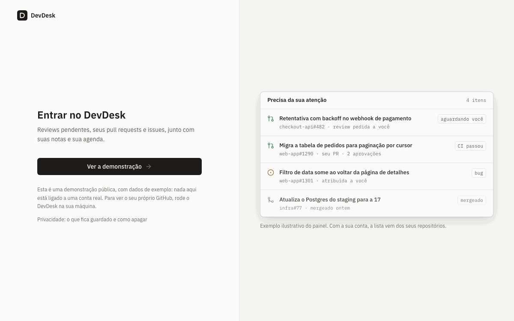
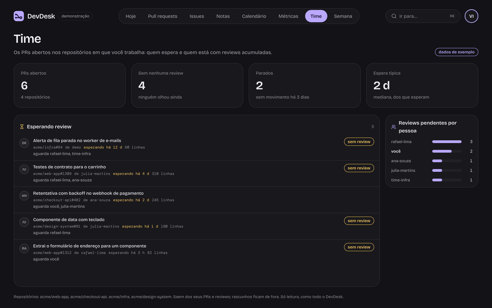
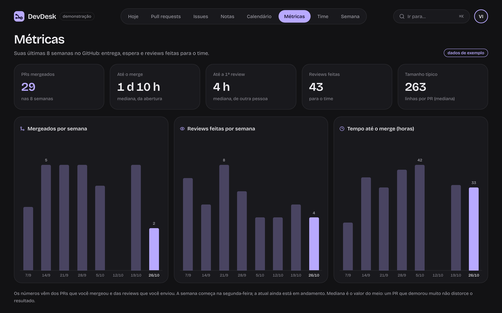
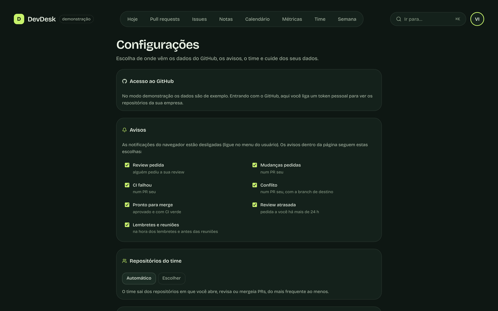
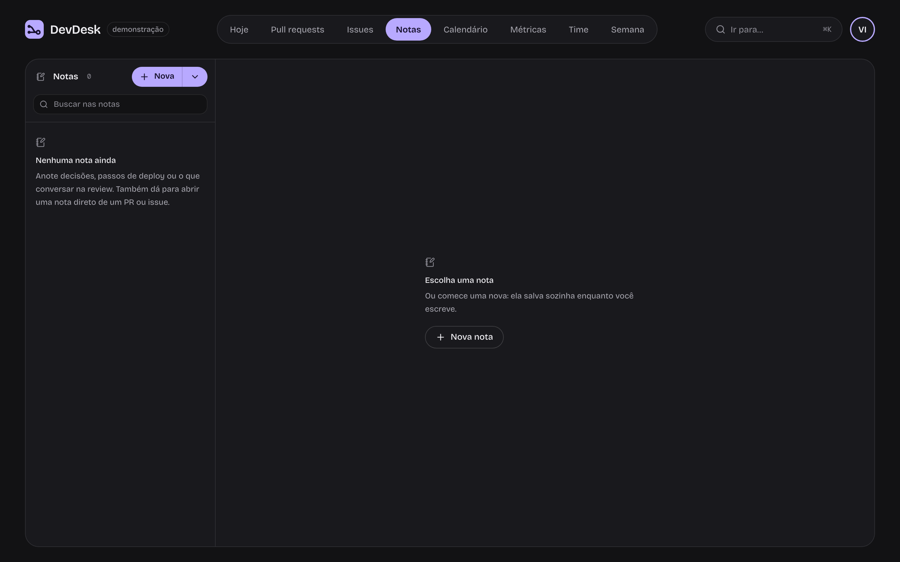
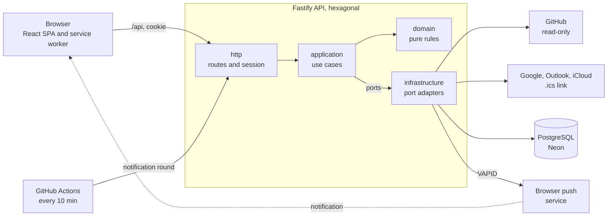

# DevDesk

[](https://github.com/MatheusBrazolin/devdesk/actions/workflows/ci.yml)
[](https://github.com/MatheusBrazolin/devdesk/actions/workflows/codeql.yml)
[](LICENSE)
[](https://devdesk-tklq.onrender.com)
[](CHANGELOG.md)

[Português](README.md) · **English**

A work dashboard for developers: what needs your attention on GitHub, your notes and your calendar, in one place.

**[Try the live demo →](https://devdesk-tklq.onrender.com)** (demo mode with sample data; the first visit may take a few seconds while the server wakes up). The interface is available in English and Portuguese.

> **Version 1.1.0.** What changed in each version is in the [CHANGELOG](CHANGELOG.md) (in Portuguese).




<table>
  <tr>
    <td></td>
    <td></td>
  </tr>
  <tr>
    <td></td>
    <td></td>
  </tr>
  <tr>
    <td></td>
    <td></td>
  </tr>
  <tr>
    <td></td>
    <td></td>
  </tr>
</table>


<sub>Screenshots from demo mode, with sample data.</sub>

## Features

- **Today**, in the Quadro look: a greeting with the day's numbers (review requests, open PRs, issues, merged), your PRs on a board by status (needs you, stale for 7+ days, in progress, merged this week with a per-day chart) and panels for PR age, load per organization, agenda and pinned notes
- **Smart review queue**: reviews requested from you are ordered by priority (how long they have waited, size and CI), with the waiting time, a reading estimate ("~15 min") and a warning once they pass 24 hours
- **Ready-made nudge** for a stale PR of yours: one click copies a polite message that already mentions who still has to review, for Slack or Teams
- **Team**: open PRs in the repositories you work on, who has been waiting longest for review, how many have no review or are stale, and whose review queue is piling up
- **My metrics** for the last 8 weeks: merged PRs, time to merge and to first review, reviews you did and the typical size of your PRs, week by week
- **Focus mode**: the most urgent item up front, the queue below, a 25 or 50 minute timer and your next appointment, without the navigation. While the timer runs, non-urgent notifications wait and arrive as a summary when the block ends. With a connected calendar it shows the free time before your next meeting and the focus block that fits in it
- **Getting started**: a short tour on the first visit (and again from the user menu) and note templates for PR review, deploy, 1:1 and bug investigation
- **TV mode**: the dashboard to keep open on a TV or in a window next to your work. Four layouts that follow the window's shape (or that you pick): **grid** for full screen, **column** for a narrow side window, **strip** for a wide band at the top or bottom and **mini** for a corner. "Open in window" places it in the right spot. Nothing scrolls: each layout scales to fit, and on a 4K TV everything is three times larger. Full screen with <kbd>F</kbd>, screen kept awake and the cursor hidden when idle
- **Installable app (PWA)**: Dock icon and its own window. Icon shortcuts for TV mode, focus and standup. Open tabs and windows stay in sync and announce new versions
- **Responsive** from 320 px to 4K: pages and board columns stack on phones, with no sideways scrolling
- **Notifications** (optional, turned on from the user menu): new review request, broken CI, changes requested, merge conflict, PR ready to merge, reminders and end of a focus block. Each item notifies only once. With the server configured, they also arrive with the app closed (Web Push), in a round every 10 minutes triggered by a free GitHub Actions schedule
- **Pull requests**: requested from you, your open ones (with CI and approvals) and the ones merged this week
- **Issues** assigned to you, grouped by repository, with labels
- **Notes** in markdown, with tags, pinned to Today and linked to PRs and issues: the notes button on each row opens or creates that item's note. They save as you type
- **Calendar** with events and reminders (all-day or timed), milestone due dates from your PRs and issues, this week's agenda on Today, reminder alerts and `.ics` export for Google Calendar, Apple Calendar or Outlook. **Connected calendars**: subscribe to your Google Calendar, Outlook or iCloud by its `.ics` link and your meetings (recurring ones included) show up in the calendar, Today, standup, TV mode and focus. Read-only; the link is encrypted and the server only fetches from known providers
- **Standup** ready to paste: what you merged, opened, reviewed and closed on the previous working day (on Monday, since Friday), what needs attention today and blocked PRs. In Slack, Markdown or plain text, editable, with copy and save as note
- **Opens instantly:** the dashboard shows the last stored snapshot and refreshes in the background; the snapshot lives in Postgres, so not even an API restart means waiting for GitHub
- **Works with organizations that block third-party apps**: anyone who signs in with GitHub and sees an empty dashboard finds, right on Today, the step to connect a personal token: the link opens GitHub with everything filled in and pasting the token connects on its own (also in Settings → GitHub access). The token acts as that person, so the company's repositories show up without asking the organization for anything. It is encrypted and only used to read
- **Settings**: which notifications to get (review requested, CI, conflict, meetings…) and which repositories make up the team
- **Your data (LGPD, Brazil's GDPR)**: a [privacy page](https://devdesk-tklq.onrender.com/privacidade) saying what is stored and for how long, "Download my data" as JSON and "Delete my account", which takes everything with it
- **One search**: <kbd>/</kbd> finds PRs, issues, notes and calendar events
- **Weekly summary**: what you shipped, reviewed and opened, what is blocked, and a text ready for your 1:1
- **Portuguese and English**: pick the language in Settings, on the login page or with <kbd>⌘</kbd> <kbd>K</kbd>
- **Token health**: where your data comes from, visible organizations, API quota and a warning a week before the token expires
- **Shortcuts**: <kbd>?</kbd> lists them all
- **Read-only on GitHub:** DevDesk never comments, approves, edits or merges; a guard in the code rejects any write
- GitHub login (OAuth) and a **demo mode** for anyone who wants to look around without connecting an account
- Cookie session (`httpOnly`), stored only as a hash; the GitHub token is encrypted (AES-256-GCM)
- **Quadro look** on every screen: graphite with a lavender accent, a top bar with pill navigation, rounded panels and cards, Bricolage Grotesque and DM Mono ([ADR 0014](docs/adr/0014-visual-quadro.md))
- Command palette (<kbd>⌘</kbd> <kbd>K</kbd>) and GitHub-style shortcuts (<kbd>g</kbd> <kbd>p</kbd> goes to pull requests)

## Roadmap

| Phase | Delivered                                                                                         |
| ----- | ------------------------------------------------------------------------------------------------- |
| 1 ✅  | Foundation: monorepo, CI, GitHub login, layout, ⌘K                                                |
| 2 ✅  | **My day**: review requests, your PRs (CI, approvals), issues, merged                             |
| 3 ✅  | **Notes** in markdown, with tags and links to PRs and issues                                      |
| 4 ✅  | **Calendar**: events, reminders and milestone due dates, with `.ics` export                       |
| 5 ✅  | Extras: standup built from yesterday's work, focus mode, notifications                            |
| 6 ✅  | **Team and routine**: review queue, metrics, team, connected calendars, notifications when closed |
| 7 ✅  | **Maturity**: privacy (LGPD), settings, CodeQL, Dependabot and version 1.0.0                      |

## Stack

| Layer     | Technology                                                              |
| --------- | ----------------------------------------------------------------------- |
| Front end | React 19, Vite, TanStack Router and Query, Tailwind CSS 4, Motion       |
| UI        | Own components on top of Radix, cmdk and lucide                         |
| API       | Node, Fastify 5, hexagonal architecture                                 |
| Data      | PostgreSQL 17, Drizzle ORM with versioned migrations                    |
| Contracts | Zod, in a package shared by front end and API                           |
| Quality   | Strict TypeScript, Vitest, Playwright, ESLint, Prettier, GitHub Actions |

## Running locally

Requires Node 24+ and Docker.

```bash
npm install
cp .env.example .env            # and fill in TOKEN_ENCRYPTION_KEY (openssl rand -base64 32)
npm run db:up                   # starts Postgres
npm run dev                     # API on :3333 and front end on http://localhost:5173
```

Migrations run on their own when the API starts. Without `GITHUB_CLIENT_ID`/`GITHUB_CLIENT_SECRET`, only demo mode shows up on the login page.

### Connecting GitHub

Run `npm run setup:github` and pick one of the two modes. The command checks everything with GitHub before writing to `.env` and never prints secrets.

**1. Personal token (recommended when it is just for you).** Create a _classic_ token at [github.com/settings/tokens/new](<https://github.com/settings/tokens/new?scopes=repo,read:org&description=DevDesk%20(local)>) with the `repo` and `read:org` scopes. It acts as you, so the dashboard sees your organizations' repositories even when they block third-party apps, without asking them for anything. Login becomes a "Sign in as <you>" button, which only exists outside production and only accepts requests from the same machine. On the published site, the owner signs in with "Continue with GitHub" and the data comes from the same token ([ADR 0011](docs/adr/0011-dono-pelo-oauth.md)).

**2. OAuth App (for several people).** At [github.com/settings/developers](https://github.com/settings/developers), create an OAuth App with:

- Homepage URL: `http://localhost:5173`
- Authorization callback URL: `http://localhost:5173/api/auth/github/callback`

Generate a Client Secret and enter both in the setup. The requested scope is `read:user read:org repo`: OAuth Apps have no read-only permission for private repositories, so GitHub shows write access on the consent screen, even though DevDesk only reads. Organizations that restrict OAuth Apps hide their repositories from the login; in that case each person connects their own personal token in Settings → GitHub access ([ADR 0012](docs/adr/0012-token-pessoal-de-cada-pessoa.md)), without asking the organization for anything.

After either one, restart the API.

### Deploying

A single Docker image (the API also serves the front end), with demo mode and a throwaway user per visit. The step-by-step guide, with a ready-made Render blueprint, is in [docs/DEPLOY.md](docs/DEPLOY.md) (in Portuguese).

## Architecture



- **A single origin:** in production the API also serves the front end, so the session cookie works without CORS.
- **Dependencies point inward:** `domain` knows nothing about the database or HTTP, and ESLint fails if anyone tries. Tests swap the adapters for in-memory versions and run without a database or network.
- **Secrets stay in the API:** the GitHub token and calendar links are encrypted (AES-256-GCM) and never go back to the browser.

## Structure

```
apps/
  api/           Fastify API, in layers (domain → application → infrastructure → http)
  web/           React SPA, organized by feature
packages/
  shared/        Zod schemas and types: the contract between front end and API
docs/
  ARCHITECTURE.md
  adr/           architecture decision records
```

The architecture is explained in [docs/ARCHITECTURE.md](docs/ARCHITECTURE.md), and the reasoning behind each choice in [docs/adr](docs/adr) (both in Portuguese).

## Scripts

| Command             | What it does                                                                                     |
| ------------------- | ------------------------------------------------------------------------------------------------ |
| `npm run dev`       | API and front end in watch mode                                                                  |
| `npm test`          | all tests                                                                                        |
| `npm run test:e2e`  | end to end in the browser (Playwright), with the app as in production; run `npm run build` first |
| `npm run typecheck` | type check across all packages                                                                   |
| `npm run lint`      | ESLint, including the layer rules                                                                |
| `npm run build`     | production build                                                                                 |

## Security

Found a vulnerability? See [SECURITY.md](SECURITY.md) to report it privately.

## License

MIT
