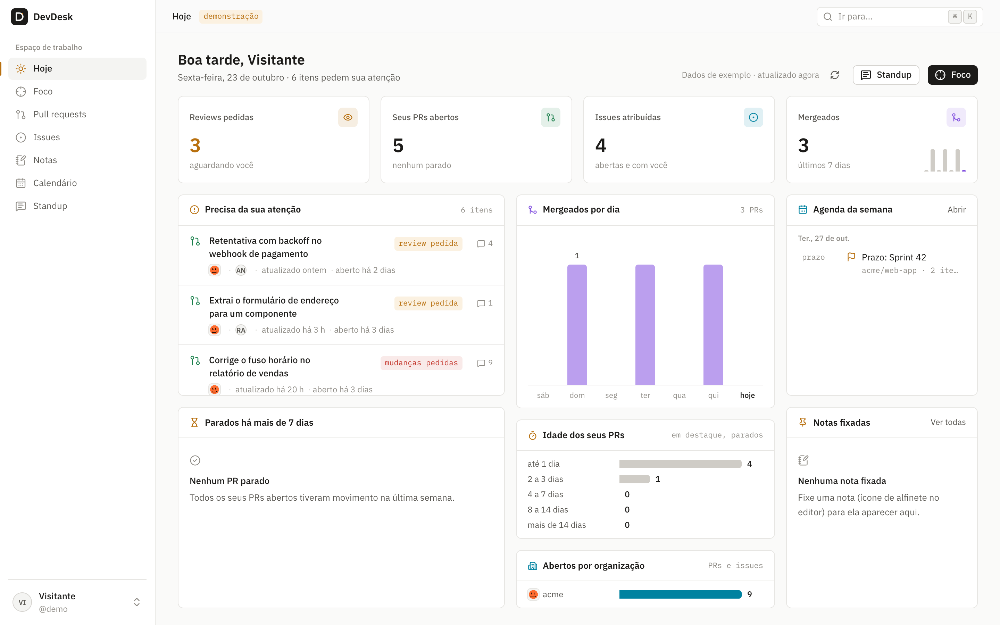
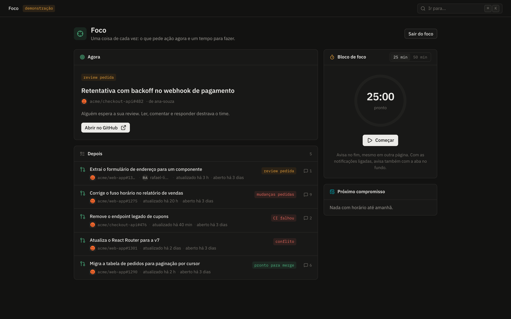
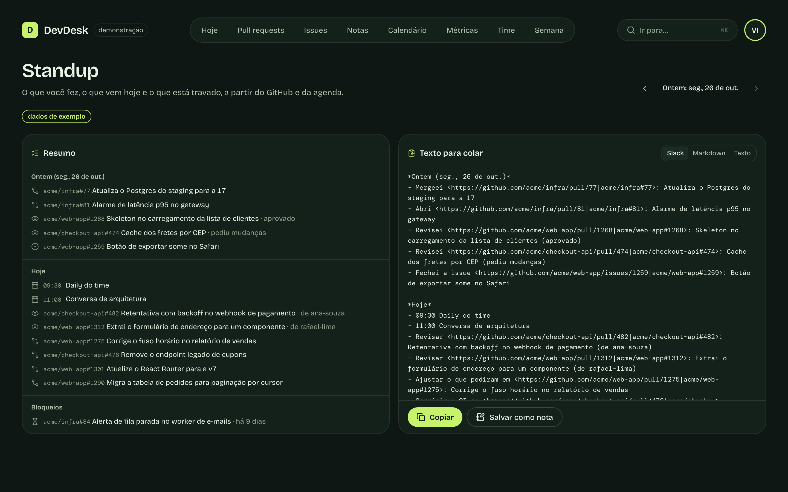
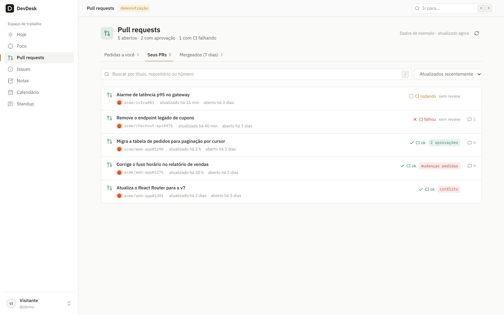
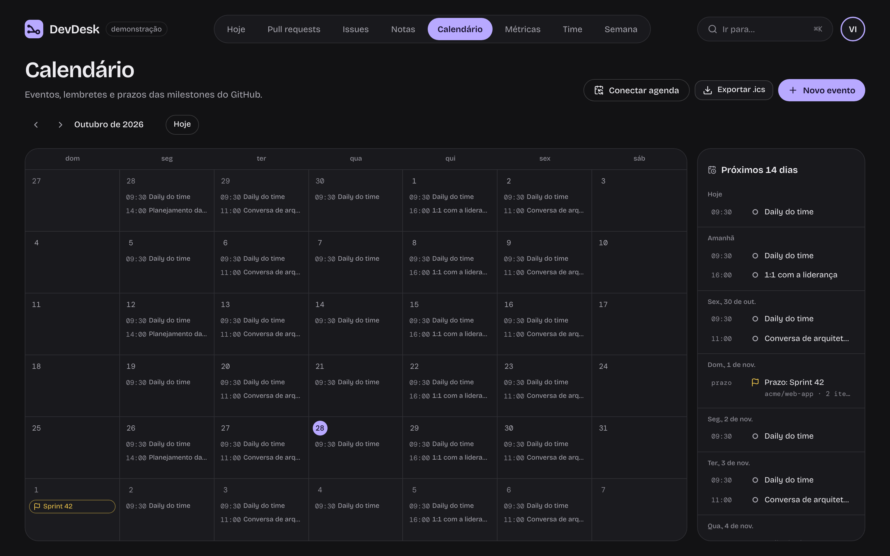
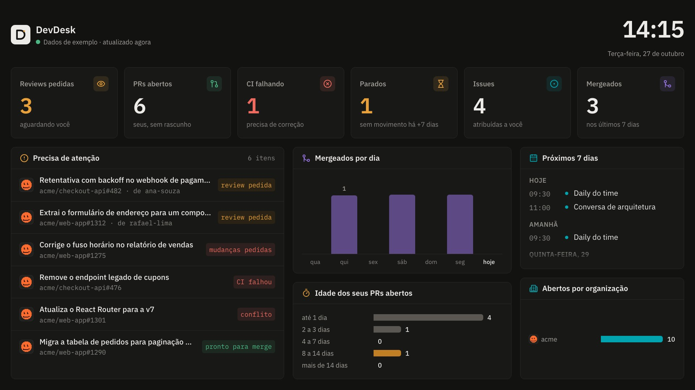

# DevDesk

[](https://github.com/MatheusBrazolin/devdesk/actions/workflows/ci.yml)
[](https://github.com/MatheusBrazolin/devdesk/actions/workflows/codeql.yml)
[](LICENSE)
[](https://devdesk-tklq.onrender.com)

Painel de trabalho para desenvolvedores: o que pede a sua atenção no GitHub, suas notas e sua agenda, num lugar só.

**[Ver a demonstração online →](https://devdesk-tklq.onrender.com)** (modo demonstração, com dados de exemplo; a primeira visita pode levar alguns segundos para o servidor acordar)

> **Estado:** as cinco fases do roteiro concluídas. Pronto para publicar como demonstração (veja [docs/DEPLOY.md](docs/DEPLOY.md)).



<table>
  <tr>
    <td></td>
    <td></td>
  </tr>
  <tr>
    <td></td>
    <td></td>
  </tr>
</table>



<sub>Capturas do modo demonstração, com dados de exemplo.</sub>

## O que já funciona

- **Hoje**, um dashboard que cabe numa tela: indicadores (reviews pedidas, PRs abertos, issues, mergeados), o que precisa da sua atenção em ordem de urgência, gráficos de mergeados por dia, idade dos seus PRs e carga por organização, PRs parados, agenda da semana e notas fixadas
- **Fila de review inteligente**: as reviews pedidas a você saem em ordem de prioridade (há quanto tempo esperam, tamanho e CI), com o tempo de espera, uma estimativa de leitura ("~15 min") e aviso quando passam de 24 horas paradas
- **Lembrete pronto** para PR seu parado: um clique copia uma mensagem educada, já marcando quem falta revisar, para colar no Slack ou no Teams
- **Time**: os PRs abertos nos repositórios em que você trabalha, quem espera review há mais tempo, quantos estão sem nenhuma review ou parados, e com quem as reviews estão acumulando
- **Minhas métricas** das últimas 8 semanas: PRs mergeados, tempo até o merge e até a primeira review, reviews que você fez e tamanho típico dos seus PRs, semana a semana
- **Modo foco**: o item mais urgente em destaque, a fila logo abaixo, um cronômetro de 25 ou 50 minutos e o próximo compromisso, sem barra lateral. Enquanto o cronômetro corre, os avisos que não são urgentes esperam e chegam num resumo no fim do bloco. Com a agenda conectada, mostra o tempo livre até a próxima reunião e o bloco de foco que cabe nele
- **Primeiros passos**: um tour curto na primeira visita (e de novo pelo menu do usuário) e modelos de nota para review de PR, deploy, 1:1 e investigação de bug
- **Modo TV**: o painel para deixar aberto numa TV ou numa janela ao lado do trabalho. Quatro arranjos que seguem o formato da janela (ou que você escolhe): **grade** para tela cheia, **coluna** para uma janela estreita ao lado, **faixa** para uma tira larga em cima ou embaixo e **mini** para um canto. "Abrir em janela" já abre no lugar certo da tela (coluna à direita ou à esquerda, faixa embaixo, canto). Nada rola: cada arranjo é ampliado para caber, e numa TV 4K tudo sai três vezes maior. Tela cheia com <kbd>F</kbd>, tela sempre acesa e cursor escondido quando parado
- **App instalável (PWA)**: ícone no Dock e janela própria, sem barra do navegador (menu do usuário → "Instalar app", ou o ícone de instalar na barra de endereço). Atalhos no ícone para o modo TV em coluna, o foco e o standup. Abas e janelas abertas ficam sincronizadas e avisam quando sai versão nova
- **Responsivo** de 320 px a 4K: no celular as páginas empilham; a partir de 1280 px o Hoje cabe numa tela só
- **Notificações** (opcionais, ligadas no menu do usuário): review nova pedida a você, CI quebrado, mudanças pedidas, conflito, PR pronto para merge, lembretes e fim do bloco de foco. Cada item avisa uma vez só. Com o servidor configurado, chegam também com o app fechado (Web Push), numa rodada a cada 10 minutos disparada por um agendador grátis do GitHub Actions
- **Pull requests**: pedidos a você, seus abertos (com CI e aprovações) e os mergeados na semana
- **Issues** atribuídas a você, agrupadas por repositório e com as labels
- **Notas** em markdown, com tags, fixadas no painel Hoje e vinculadas a PRs e issues: o botão de notas em cada linha abre ou cria a nota daquele item. Salvam sozinhas enquanto você escreve
- **Calendário** com eventos e lembretes (dia inteiro ou com horário), os prazos das milestones dos seus PRs e issues, a agenda da semana no painel Hoje, aviso na hora dos lembretes e exportação `.ics` para Google Agenda, Apple Calendar ou Outlook. **Agendas conectadas**: assine o seu Google Agenda, Outlook ou iCloud pelo link `.ics` e as reuniões (inclusive as que se repetem) aparecem no calendário, no Hoje, no standup, no modo TV e no foco. Só leitura; o link fica cifrado e o servidor só busca em provedores conhecidos
- **Standup** pronto para colar: o que você mergeou, abriu, revisou e fechou no dia útil anterior (na segunda, desde sexta), o que pede atenção hoje e os PRs travados. Em Slack, Markdown ou texto, editável, com cópia e salvar como nota
- **Abre na hora:** o painel mostra o último retrato guardado e atualiza por trás; o retrato fica no Postgres, então nem depois de reiniciar a API é preciso esperar o GitHub
- **Configurações**: quais avisos receber (review pedida, CI, conflito, reuniões…) e quais repositórios formam o time
- **Seus dados (LGPD)**: página de [privacidade](https://devdesk-tklq.onrender.com/privacidade) dizendo o que fica guardado e por quanto tempo, "Baixar meus dados" em JSON e "Apagar minha conta", que leva tudo junto
- **Atalhos**: <kbd>?</kbd> mostra todos
- **Só leitura no GitHub:** o DevDesk nunca comenta, aprova, edita nem faz merge; uma trava no código recusa qualquer escrita
- Login com GitHub (OAuth) e **modo demonstração**, para quem quer conhecer sem conectar uma conta
- Sessão por cookie `httpOnly`, com o token guardado só como hash; o token do GitHub fica cifrado (AES-256-GCM)
- Layout com sidebar animada, gaveta no celular, tema claro/escuro/sistema
- Paleta de comandos (<kbd>⌘</kbd> <kbd>K</kbd>) e atalhos no estilo do GitHub (<kbd>g</kbd> <kbd>p</kbd> vai para os pull requests)

## Roteiro

| Fase | Entrega                                                                           |
| ---- | --------------------------------------------------------------------------------- |
| 1 ✅ | Fundação: monorepo, CI, login com GitHub, layout, ⌘K                              |
| 2 ✅ | **Meu dia**: reviews pedidas a você, seus PRs (CI, aprovações), issues, mergeados |
| 3 ✅ | **Notas** em markdown, com tags e vínculo com PRs e issues                        |
| 4 ✅ | **Calendário**: eventos, lembretes e prazos de milestones, com exportação `.ics`  |
| 5 ✅ | Extras: standup gerado do que você fez ontem, modo foco, notificações             |

## Stack

| Camada    | Tecnologia                                                               |
| --------- | ------------------------------------------------------------------------ |
| Front     | React 19, Vite, TanStack Router e Query, Tailwind CSS 4, Motion          |
| UI        | Componentes próprios sobre Radix, cmdk e lucide                          |
| API       | Node, Fastify 5, arquitetura hexagonal                                   |
| Dados     | PostgreSQL 17, Drizzle ORM com migrações versionadas                     |
| Contratos | Zod, num pacote compartilhado entre front e API                          |
| Qualidade | TypeScript estrito, Vitest, Playwright, ESLint, Prettier, GitHub Actions |

## Rodando localmente

Precisa de Node 24+ e Docker.

```bash
npm install
cp .env.example .env            # e preencha TOKEN_ENCRYPTION_KEY (openssl rand -base64 32)
npm run db:up                   # sobe o Postgres
npm run dev                     # API em :3333 e front em http://localhost:5173
```

As migrações rodam sozinhas quando a API sobe. Sem `GITHUB_CLIENT_ID`/`GITHUB_CLIENT_SECRET`, só o modo demonstração aparece no login.

### Conectando o GitHub

Rode `npm run setup:github` e escolha um dos dois modos. O comando confere tudo com o GitHub antes de gravar no `.env` e nunca mostra segredos na tela.

**1. Token pessoal (recomendado para uso só seu).** Crie um token _classic_ em [github.com/settings/tokens/new](<https://github.com/settings/tokens/new?scopes=repo,read:org&description=DevDesk%20(local)>) com os escopos `repo` e `read:org`. Ele age como você, então o painel enxerga os repositórios das suas organizações mesmo quando elas bloqueiam apps de terceiros, sem pedir nada a elas. O login vira um botão "Entrar como <você>". O botão "Entrar como" só existe fora de produção e só aceita acesso da própria máquina. No site publicado, o dono entra por "Continuar com GitHub" e os dados vêm do mesmo token ([ADR 0011](docs/adr/0011-dono-pelo-oauth.md)): as organizações aparecem sem nenhum pedido a elas.

**2. OAuth App (para várias pessoas).** Em [github.com/settings/developers](https://github.com/settings/developers), crie um OAuth App com:

- Homepage URL: `http://localhost:5173`
- Authorization callback URL: `http://localhost:5173/api/auth/github/callback`

Gere um Client Secret e informe os dois no setup. O escopo pedido é `read:user read:org repo`: OAuth Apps não têm permissão só de leitura para repositórios privados, então o GitHub mostra acesso de escrita na autorização, embora o DevDesk só faça leituras. Organizações que restringem OAuth Apps precisam liberar o app para os repositórios delas aparecerem.

Depois de qualquer um dos dois, reinicie a API.

### Publicando

Uma imagem Docker só (a API serve também o front), com o modo demonstração e um usuário descartável por visita. O passo a passo, com um blueprint pronto para o Render, está em [docs/DEPLOY.md](docs/DEPLOY.md).

## Estrutura

```
apps/
  api/           API Fastify, em camadas (domain → application → infrastructure → http)
  web/           SPA React, organizada por feature
packages/
  shared/        schemas Zod e tipos: o contrato entre front e API
docs/
  ARCHITECTURE.md
  adr/           registro das decisões de arquitetura
```

A arquitetura está explicada em [docs/ARCHITECTURE.md](docs/ARCHITECTURE.md), e o porquê de cada escolha, em [docs/adr](docs/adr).

## Scripts

| Comando             | O que faz                                                                                       |
| ------------------- | ----------------------------------------------------------------------------------------------- |
| `npm run dev`       | API e front em modo watch                                                                       |
| `npm test`          | todos os testes                                                                                 |
| `npm run test:e2e`  | ponta a ponta no navegador (Playwright), com o app como em produção; rode `npm run build` antes |
| `npm run typecheck` | checagem de tipos em todos os pacotes                                                           |
| `npm run lint`      | ESLint, incluindo as regras de camadas                                                          |
| `npm run build`     | build de produção                                                                               |

## Segurança

Achou uma falha? Veja [SECURITY.md](SECURITY.md) para reportar em particular.

## Licença

MIT
